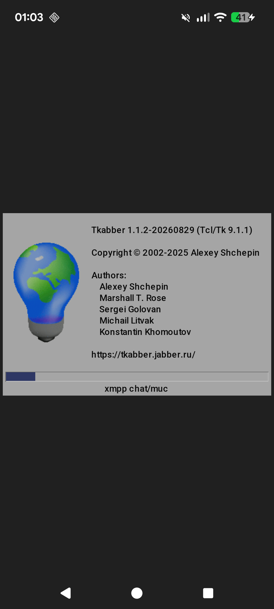
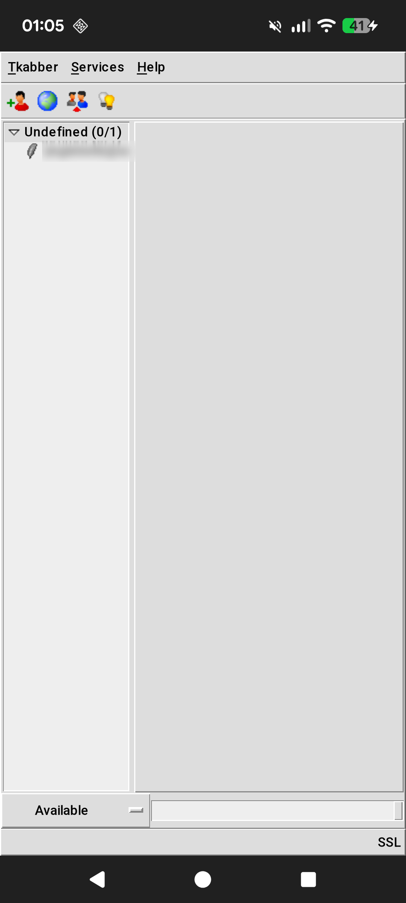

# Tkabber on Android

A demonstration of [Tk for Android](https://github.com/pounceandmiss/tk-wayland)
(the `android` branch of `tk-wayland`, which also has the native Wayland port):
[Tkabber](https://chiselapp.com/user/sgolovan/repository/tkabber), a
full-featured XMPP client written in Tcl/Tk over two decades, running as a
native Android app. Tkabber's code is unchanged except for one small fix (below);
the work is in the Tk port, which was written mostly by Claude with human
supervision.

<p>
  
  
</p>

## Try it

Download `tkabber-android-arm64.apk` from
[Releases](https://github.com/pounceandmiss/tkabber-demo/releases) and install
it (Android 11 or later, 64-bit ARM; you need to allow installing from unknown
sources). It is signed with a debug key.

## What is in this repository

- **Tkabber and TclXMPP** as of upstream trunk on 2026-08-29, imported from the
  Debian source package (see the first commit for the checksums). TclXMPP is in
  `tclxmpp/`. Their history is in their Fossil repositories on
  [Chiselapp](https://chiselapp.com/user/sgolovan/repository/tkabber).
- **One fix to Tkabber** (`login.tcl`): the CA certificate store defaults to
  `/etc/ssl/certs` only if it exists. Android has no such directory, and the
  missing path stopped TLS from verifying any server.
- **`android/`**: the packaging, which is not part of Tkabber.
  - `build.sh` builds the APK (see below).
  - `tls.mk` cross-builds OpenSSL and tcltls, which are linked statically into
    the app; `tlsinit.c` registers tcltls as a static package.
  - `main.tcl` starts Tkabber, after collecting Android's CA certificates for
    OpenSSL; `tls/android.tcl` passes them to `tls::import`.
  - `res/` holds the launcher icon (Tkabber's logo).

## Building

You need a checkout of the Android build of Tk, set up as described in
`tk/android/README.md` of
[tk-wayland](https://github.com/pounceandmiss/tk-wayland): a directory `TOP`
with the Tk sources (`android` branch) in `tk`, Tcl in `tcl`, the Android SDK
in `android-sdk`, and the `tk-android-build` Docker image built from
`tk/android/build/Dockerfile`. Then:

```
android/build.sh TOP
```

downloads OpenSSL 3.6.5, tcltls 2.0.1, tcllib 2.0 and BWidget 1.10.1 from their
upstreams (checksums are checked), builds everything with the NDK, and writes
`TOP/build/tkabber-arm64-v8a/tkabber.apk`. Set `ANDROID_ABI=x86_64` for the
emulator.

## Licenses

Tkabber is under the GNU GPL, version 2 or later (`COPYING`); TclXMPP under a
BSD-style license (`tclxmpp/license.terms`). The APK also contains Tcl/Tk,
tcllib and BWidget (BSD-style), tcltls (BSD-style) and OpenSSL (Apache 2.0).
